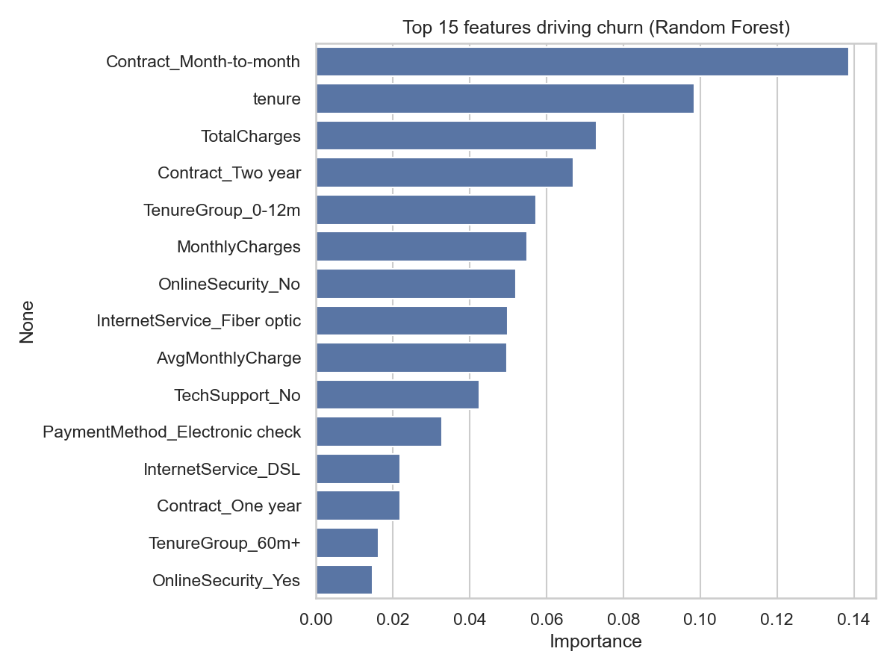
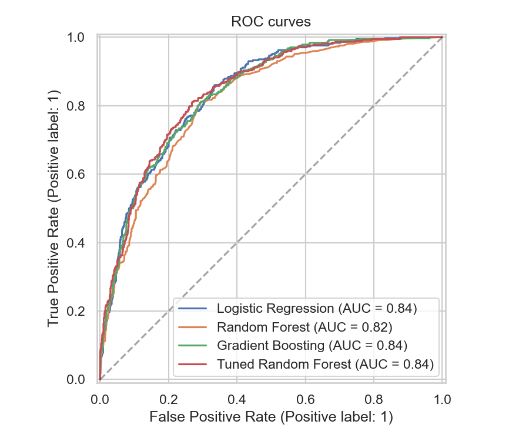

# Customer Churn Prediction – Machine Learning Model

Predicts whether a telecom customer will **leave or stay**, so a business can target at-risk customers with retention offers before they churn.

**Dataset:** [Telco Customer Churn (Kaggle / IBM)](https://www.kaggle.com/datasets/blastchar/telco-customer-churn) – 7,043 customers, 20 features
**Tech:** Python, Pandas, NumPy, Scikit-learn, Matplotlib, Seaborn

---

## Project Highlights

- **Data cleaning** – fixed blank `TotalCharges` values (new customers), removed ID column, encoded target.
- **Feature engineering** – created `AvgMonthlyCharge` (TotalCharges ÷ tenure) and `TenureGroup` (0-12m, 13-24m, 25-48m, 49-60m, 60m+).
- **Class imbalance** – only ~26% of customers churned, so I used a **stratified train/test split** and **class weights**.
- **Model comparison** – Logistic Regression vs Random Forest vs Gradient Boosting, evaluated on **recall** and **ROC-AUC** (recall matters most: missing a churner costs more than a false alarm).
- **Hyperparameter tuning** – Random Forest tuned with **GridSearchCV** (5-fold CV).
- **Explainability** – feature importance to find the main churn drivers: **contract type, tenure and monthly charges**.

## Project Structure

```
customer-churn-prediction/
├── app.py                  # interactive Streamlit dashboard
├── churn_prediction.py     # training pipeline: clean → features → train → tune
├── data/                   # put the dataset CSV here
├── outputs/                # plots, metrics, saved model (generated)
├── requirements.txt
└── README.md
```

## Interactive Web App

Launch the Streamlit dashboard locally:

```bash
streamlit run app.py
```

For public hosting, push this project to GitHub and deploy it on Streamlit Community Cloud using `app.py` as the main file. Streamlit provides the public URL after deployment.

## How to Run

```bash
# 1. clone and install
git clone https://github.com/<your-username>/customer-churn-prediction.git
cd customer-churn-prediction
pip install -r requirements.txt

# 2. the Telco Customer Churn CSV is already included in data/
#    If replacing it, keep this path:
#    data/WA_Fn-UseC_-Telco-Customer-Churn.csv

# 3. run the pipeline
python churn_prediction.py
# optional: faster, smaller grid search
python churn_prediction.py --quick
```

Outputs are written to `outputs/`:

| File | Description |
|---|---|
| `model_comparison.csv` | Recall / precision / F1 / ROC-AUC for all models |
| `best_params.json` | Best Random Forest hyperparameters |
| `feature_importance_top15.csv` | Top churn drivers |
| `01_…06_*.png` | Class balance, churn by segment, ROC curves, confusion matrix, feature importance |
| `churn_model.joblib` | Saved tuned model (full pipeline, ready for `.predict()`) |

## Results

Measured on the held-out 20% test set (1,405 customers):

| Model | Recall | ROC-AUC |
|---|---|---|
| Logistic Regression | 0.774 | 0.840 |
| Random Forest | 0.438 | 0.820 |
| Gradient Boosting | 0.755 | 0.838 |
| **Tuned Random Forest** | 0.763 | 0.843 |

### Feature Importance



### ROC Curves



## Key Findings

- Customers on **month-to-month contracts** churn far more than those on 1- or 2-year contracts.
- **Short tenure** (especially the first 12 months) is the strongest warning sign.
- **Higher monthly charges** (e.g. fiber optic plans) are linked to higher churn.

**Business takeaway:** push new customers toward longer contracts, and offer early-tenure retention incentives to high-bill customers.

## Using the Saved Model

```python
import joblib, pandas as pd
model = joblib.load("outputs/churn_model.joblib")
# new_customers must contain the same columns as training data (incl. AvgMonthlyCharge, TenureGroup)
probs = model.predict_proba(new_customers)[:, 1]
```

## Future Improvements

- Try XGBoost / LightGBM and SMOTE
- Tune the decision threshold for a recall/precision trade-off
- Add SHAP explanations

## License
MIT
